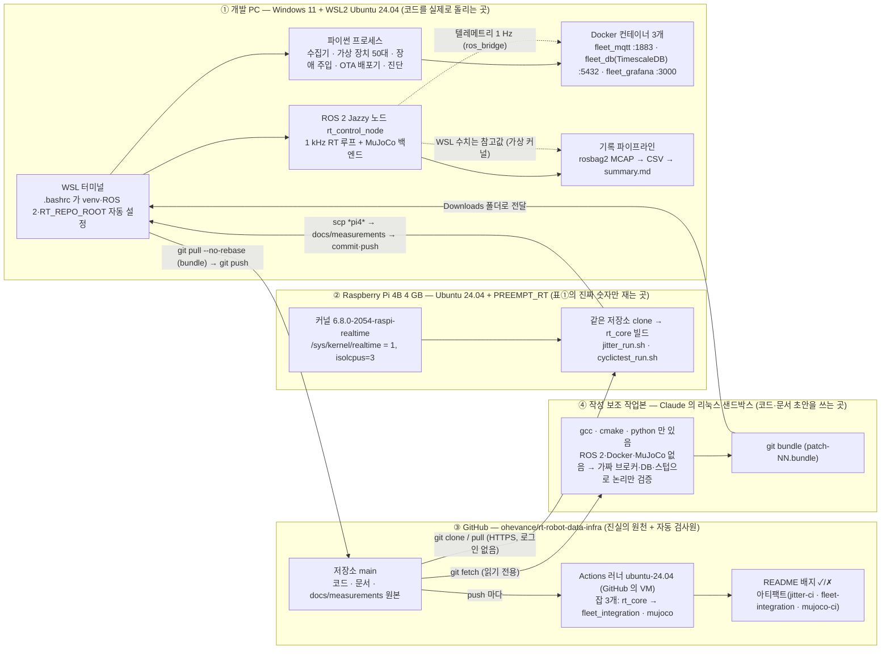
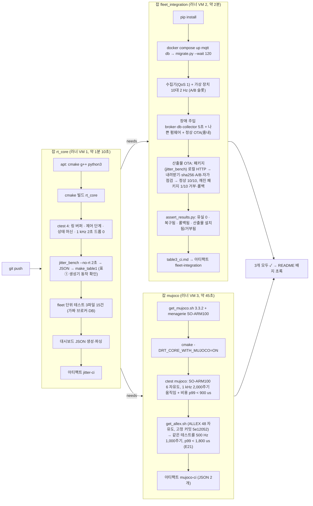
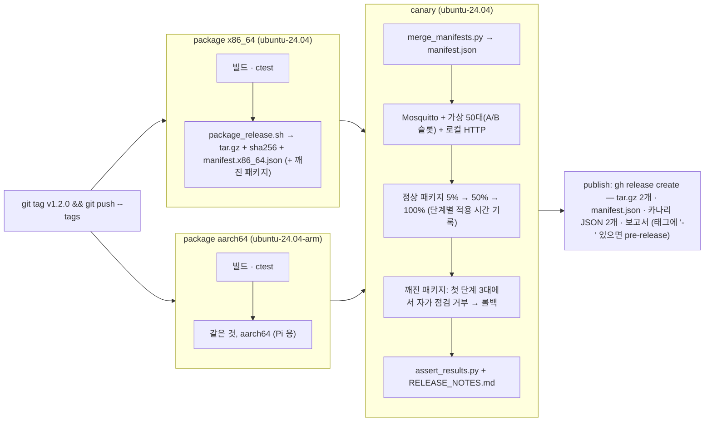

# 전체 환경 지도 — 무엇이 어디서 돌고, 왜 거기인지, 언제 움직이고, 결과를 보고 무엇을 판단하나

`ARCHITECTURE.md` 가 **소프트웨어의 구조**(RT 루프·수집기·OTA 가 어떻게 생겼나)라면, 이 문서는 **환경의 구조**다 —
컴퓨터 네 곳(개발 PC · Raspberry Pi · GitHub · 작성 보조 작업본)에 무엇이 있고, 코드와 숫자가 어느 길로 오가며, 각 곳의 결과를 어떻게 읽는가.
처음 읽는 사람 기준으로 썼다. 용어는 처음 나올 때 풀고, 판단 기준은 표로.

## 0. 한 장 그림

읽는 법: **실선은 코드와 숫자가 실제로 흐르는 길**, 점선은 참고 관계. GitHub 가 가운데에 있는 이유는 네 곳 모두 GitHub 를 기준으로 맞추기 때문이다(Pi 도, 작업본도, PC 도 `main` 에서 받는다).

## 1. 네 곳이 각각 왜 필요한가 (한 곳으로는 안 되는 이유)

| 곳 | 하는 일 | 왜 여기여야 하나 | 못 하는 것 |
|---|---|---|---|
| ① 개발 PC (WSL2) | 모든 코드를 **실제로 돌린다** — ROS 2 노드, 관제 컨테이너, 가상 장치 50대, 장애 주입, 기록 | 12 CPU·Docker·ROS 2 가 있는 유일한 곳. 사람이 보는 Grafana 화면도 여기 | **실시간 지연 수치** — WSL2 는 가상 커널이라 max 가 1 ms 턱밑(921~2,026 us). 그래서 WSL 숫자는 전부 "참고값" 표기 |
| ② Raspberry Pi 4 | **표① 하나만** 잰다 — 일반 커널 vs PREEMPT_RT, 고정, 격리 | 진짜 하드웨어 + 진짜 RT 커널이 있는 유일한 곳. 4코어라 격리 실험이 된다 | ROS 2·Docker·MuJoCo 없음(안 깐다). GitHub 로그인도 없다 — 측정만 하고 커밋은 WSL 에서 |
| ③ GitHub | 저장소(이력 전체) + **CI**(push 마다 자동 검사) + 공개 링크(이력서·영상) | 어느 PC 에서도 같은 코드를 받는 기준점. CI 는 "내 PC 에서만 되는" 문제를 걸러 준다(매번 새 VM) | RT 커널·RT 권한이 없어 지연 **수치**를 못 잰다 → "돌아간다" 의 증거이지 "얼마나 빠르다" 의 증거가 아니다 |
| ④ 작성 보조 작업본 | 코드·문서 초안을 쓰고, 컴파일·단위 테스트까지 돌려 본 뒤 **bundle** 로 넘긴다 | 작성자가 읽고 검토할 수 있게 작은 패치 단위로 전달하기 위해 | 네트워크가 막혀 ROS 2·Docker·MuJoCo 없음 → 가짜(fake_mqtt·fake_psycopg·MuJoCo 스텁)로 논리만. **진짜 실행은 항상 ① 이 처음** |

비유: ① 작업장, ② 계측실(진동 없는 방), ③ 도면 보관소 겸 검사원, ④ 설계 사무실. 설계 사무실에서 그린 도면(bundle)은 작업장에서 먼저 조립해 보고(WSL 실행), 보관소에 올리면 검사원이 매번 다시 조립해 본다(CI). 계측실은 한 가지 측정(지연)만 하고 결과지를 작업장으로 보낸다(scp).

## 2. 코드와 숫자가 오가는 길 (언제, 무엇이 움직이나)

| 길 | 트리거 | 명령 | 결과 확인 |
|---|---|---|---|
| ④ → ① 패치 전달 | 작업본이 커밋을 만들면 | `patch-NN.bundle` 이 `C:\Users\…\Downloads\` 에 놓임 → [WSL] `git pull --no-rebase --no-edit /mnt/c/Users/<사용자>/Downloads/patch-NN.bundle main` | `Fast-forward` 와 파일 목록. `--rebase` 금지(이력을 다시 써서 충돌 — 11/04) |
| ① → ③ 공개 | 사람이 결정할 때 | `git push` (push 는 항상 사람이) | `main -> main` 줄. 몇 분 뒤 CI |
| ③ → ④ 기준 맞추기 | 패치를 만들기 전 | 작업본이 `git fetch`(읽기 전용) | 패치의 기준 커밋이 사용자의 main 과 같음 — "lacks prerequisite" 오류가 안 남 |
| ③ → ② Pi 갱신 | 측정 스크립트가 바뀌었을 때 | [Pi] `git pull` | untracked 결과 파일이 있으면 막힌다 → `rm -f docs/measurements/*pi4*` 뒤 pull(GitHub 에 이미 있음) |
| ② → ① → ③ 측정 결과 | 측정이 끝났을 때 | [WSL] `scp '<사용자>@<Pi IP>:~/rt-robot-data-infra/docs/measurements/*pi4*' docs/measurements/` → `make_table1.py` → commit → push | `table1_pi4.md` 줄 수, 각 줄의 "스로틀 0" |
| ① 안 기록 → 저장소 | 기록 실험 뒤 | `summary.md`·`rt_status.csv` 만 `docs/measurements/` 로 복사(MCAP 원본은 `build/`, 제외) | `record_*` 파일 |

규칙 두 개: **커밋 주체는 ① 하나**(Pi 도 작업본도 push 하지 않는다 — 이력이 한 줄로 남고 자격 증명이 한 곳에만 있다). **숫자는 원본 파일과 함께**(`docs/measurements/README.md` 규칙).

## 3. ① 개발 PC — 무엇이 떠 있어야 하고, 무엇을 보고 판단하나

| 구성 | 띄우는 법 | "정상" 의 신호 | 비정상이면 |
|---|---|---|---|
| WSL 터미널 | 새 창 | 프롬프트 앞 `(.venv)`, `echo $RT_REPO_ROOT` 가 저장소 경로 | `.bashrc` 블록 확인(`docs/SETUP_WSL.md`) |
| 관제 컨테이너 3개 | `docker compose -f fleet/docker-compose.yml up -d` | `docker ps` 에 fleet_mqtt·fleet_db·fleet_grafana 가 Up, Grafana `localhost:3000` 열림 | `docker compose … logs <이름>` |
| 수집기 | `python3 fleet/collector/collector.py --qos 1` (한 번에 하나 — flock) | 1초마다 `msgs/s=50 online=50 … backlog=0 db_err=0` | `backlog` 증가 = DB 죽음, `online` 급감 = 브로커/장치 문제, "이미 수집기가 떠 있습니다" = 중복 실행 |
| 가상 장치 | `python3 fleet/agent/virtual_fleet.py --count 50 --rate 1 --telemetry-qos 1` | 수집기의 `online=50` | `reconnects` 가 계속 늘면 client_id 충돌(두 벌 실행) |
| ROS 2 노드 | `./install/rt_control_ros2/lib/rt_control_ros2/rt_control_node --ros-args --params-file rt_control/ros2_adapter/config/so101_mujoco.params.yaml` | 시작 로그 `backend=mujoco dof=6 loop=1000 Hz`, `ros2 topic echo /rt_status --once` 의 `timing_drops: 0`, `state: RUNNING` | 토픽이 안 보이면 `ros2 daemon stop`(RMW 꼬임) · `pkill -f rt_control_node` 로 고아 정리 |
| 기록 | `bash data_pipeline/record.sh 30` → `bag_to_csv.py` | `summary.md` 에 실제 Hz = 설계 Hz, 틈 0, 드롭 0 | 조용히 안 끝나면 정지된 것(SIGTTIN) — `pkill -CONT` 뒤 `-INT` |

WSL 에서 나오는 **지연 수치는 전부 참고값**이다(가상 커널). 표①의 진짜 값은 ②.

## 4. ② Raspberry Pi — 측정 환경의 "유효 조건"

| 확인 | 명령 | 정상 | 아니면 |
|---|---|---|---|
| RT 커널인가 | `uname -r; cat /sys/kernel/realtime` | `…-raspi-realtime` / `1` | `pro enable realtime-kernel --variant=raspi` 다시, 재부팅 |
| 격리 | `cat /sys/devices/system/cpu/isolated` | `3` | `/boot/firmware/cmdline.txt` 끝에 `isolcpus=3 nohz_full=3 rcu_nocbs=3` |
| 클럭 고정 | `cat /sys/devices/system/cpu/cpu0/cpufreq/scaling_governor` | `performance` | `echo performance \| sudo tee …/scaling_governor` |
| 열·스로틀 | `cat /sys/class/thermal/thermal_zone0/temp; cat /sys/devices/platform/soc/soc:firmware/get_throttled` | 시작 50 °C 아래, 플래그 `0` | 식힌다. 플래그가 0 이 아니면 그 측정은 버린다(`GLOSSARY.md` "스로틀") |
| 측정 결과의 판단 | 각 스크립트 끝의 `temp: a -> b mC \| throttled: 0` | 0 | 0 아니면 재측정 |

Pi 는 측정 외의 일을 하지 않는다(ROS 2·Docker 없음). 자세한 순서는 `SETUP_RT_MEASURE.md`, 결과 해석은 `experiments/E18.md`·`E19a~d.md`.

## 5. ③ GitHub Actions(CI) — 환경, 필요성, 동작, 판단

### 5-1. 환경: 내 노트북이 아니라 GitHub 의 컴퓨터
push 하면 GitHub 가 자기 데이터센터에 **리눅스 가상 머신(러너, `ubuntu-24.04`)을 새로 켜서** 저장소를 받아 `.github/workflows/ci.yml` 대로 실행하고 끈다. 공개 저장소는 무료. 노트북을 꺼도 돈다. 러너는 매번 백지라 의존성은 step 에서 다시 깐다(`apt-get install`, `get_mujoco.sh`, `pip install`).

### 5-2. 왜 필요한가
- "내 PC 에서는 됐다"를 **남의 깨끗한 컴퓨터에서 다시 증명**한다. 실제로 CI 만 잡은 문제가 둘 있다(5-5).
- 포트폴리오를 보는 사람이 코드를 안 돌려 봐도 **초록 배지 하나로** "빌드되고 테스트가 통과한다"를 안다.
- 문서 커밋 하나라도 push 마다 전부 다시 돈다 → 어느 커밋에서 깨졌는지 커밋 단위로 찾힌다.

### 5-3. 언제, 무엇이 도나
트리거(`on:`): `push`(모든 브랜치), `pull_request`, `workflow_dispatch`(Actions 탭의 "Run workflow" 버튼). 한 번의 push = **run** 하나(번호 예 41964542012) = 잡 3개.

`needs: rt_core` 때문에 1단계가 실패하면 2단계 둘은 돌지 않는다(싼 검사부터, 비싼 검사는 그 뒤).

### 5-4. 결과를 보고 무엇을 판단하나
| 보는 곳 | 명령/위치 | 판단 |
|---|---|---|
| 배지 | README 맨 위 | 초록 = 마지막 push 가 3잡 통과. **빨강이면 다른 일보다 먼저** 본다 — 포트폴리오 첫 화면 |
| run 목록 | `gh run list -L 3` 또는 `github.com/ohevance/rt-robot-data-infra/actions` | ✓/✗/● (진행 중). 몇 번째 커밋부터 ✗ 인지 |
| 어느 잡이 깨졌나 | `gh run view <ID>` | 잡 이름이 곧 원인 영역: `rt_core` = 빌드·단위 테스트(코드 자체) · `fleet_integration` = 컨테이너·프로세스 간 타이밍·네트워크 · `mujoco` = 외부 다운로드·모델 경로 |
| 왜 깨졌나 | `gh run view <ID> --log-failed \| tail -40` | 마지막 40줄에 거의 항상 답이 있다(`NameError`, `FAIL:`, `Error:`) |
| 숫자 보기 | Actions → 아티팩트 다운로드, 또는 `gh run download <ID>` | `table1_ci.md`, `table3_ci.md`, `mujoco_backend_ci.json` — 러너 숫자는 "돌아간다" 의 증거. 지연 절대값은 ② 와 비교하지 않는다 |

실패 유형별 첫 행동:
| 증상 | 뜻 | 첫 명령 |
|---|---|---|
| `rt_core` 의 ctest 실패 | 코드 논리가 깨짐(WSL 에서도 깨질 것) | WSL 에서 `ctest --test-dir build/rt_core --output-on-failure` |
| `rt_core` 의 fleet 단위 테스트 `FAIL:` | 수집기·OTA·에이전트 논리 | `python3 fleet/tests/test_*.py` |
| `fleet_integration` 에서 "장치 0대" | 수집기나 가상 장치가 시작 직후 죽음 | 로그에서 traceback 찾기(11/05 `NameError`) |
| `fleet_integration` 에서 복구 시간 초과 | 타이밍·컨테이너 준비(11/04 TimescaleDB 임시 서버) | `migrate.py --wait` 가 지났는지, `settle` 값 |
| `mujoco` 다운로드 실패 | 외부 URL·버전 | `scripts/get_mujoco.sh` 의 버전과 `ci.yml` 의 `MUJOCO_VERSION` 일치 |
| 액션 해석 실패("Unable to resolve action") | `uses:` 버전이 없음 | `checkout@v5`, `upload-artifact@v5` 확인 |

### 5-5. CI 가 실제로 잡은 것 (왜 있어야 하는지의 증거)
| 날짜 | 무엇 | WSL 에서 안 보인 이유 | 기록 |
|---|---|---|---|
| 11/04 | TimescaleDB 첫 기동의 **임시 서버**에 `pg_isready` 가 속아 migrate 가 끊김 | WSL 볼륨엔 데이터가 이미 있어 init 단계가 없었다 | `LOG.md` "GitHub 첫 push · CI 1차", `experiments/E13.md` |
| 11/05 | 수집기 `request_stop` 함수 삭제(`NameError`) — 수집기가 시작 직후 죽음 | 단위 테스트가 `main()` 을 안 탔고, WSL 에서 수집기를 다시 띄운 적이 없었다 | `LOG.md` 11/05, `test_collector_resilience` 에 main() 스모크 추가 |

배운 규칙: **문서 커밋이라도 push 뒤 `gh run list -L 1` 을 본다.** 11/05 에 측정·문서 push 를 연달아 하며 CI 를 안 봐서 빨간 상태로 몇 시간이 갔다.

### 5-5b. 두 번째 워크플로 — `release.yml` (태그 → 게시), 11/10
`ci.yml` 이 "이 커밋이 멀쩡한가"를 묻는다면, `release.yml` 은 "이 커밋을 로봇에 내보내도 되나"를 묻는다. `v*` 태그를 push 할 때만 돈다.

- 러너는 LAN 의 실물에 직접 배포하지 않는다. 게시된 Release 를 운영자가 `rollout.py --manifest <URL>` 로 밀어 넣거나(승인), 실물 Pi 가 `releases/latest` 를 스스로 읽는다(자율). 왜 그런지는 `docs/RELEASE.md` 4절, `docs/DECISIONS.md` 11/10.
- 러너 종류: x86_64 는 `ubuntu-24.04`, aarch64 는 GitHub 의 Linux arm64 호스팅 러너 `ubuntu-24.04-arm`(공개 저장소 무료). 둘 다 네이티브 빌드라 교차 컴파일 설정이 없다.

### 5-6. Jenkins 에 익숙한 사람을 위한 대응표
| Jenkins | GitHub Actions | 이 저장소 |
|---|---|---|
| Jenkins 서버(직접 운영) | GitHub 가 운영 | — |
| 빌드 노드 / agent | runner | `runs-on: ubuntu-24.04` |
| Job(파이프라인 하나) | **workflow**(yml 파일 하나) | `ci.yml` |
| Jenkinsfile | 그 yml | `ci.yml` |
| 트리거(polling·webhook·수동) | `on:` | push · pull_request · workflow_dispatch |
| stage | **job**(각자 다른 runner) | rt_core · fleet_integration · mujoco |
| `sh` 한 줄 | step(`run:`/`uses:`) | "Configure & build" … |
| 플러그인 | action(`uses: actions/checkout@v5`) | checkout · upload-artifact |
| upstream/downstream | `needs:` | 2단계 둘이 `needs: rt_core` → 병렬 |
| Build #123 | run(ID) | `gh run list` 한 줄 |
| 콘솔 출력 | job 로그 | `gh run view <ID> --log-failed` |
| JUnit 리포트 화면 | (없음 — 로그의 OK/FAIL) | 필요하면 JUnit XML + 리포터 액션 30분 |

### 5-7. 테스트 목록 — "테스트 케이스 등록"은 따로 없다, 전부 저장소의 코드다
| 묶음 | 파일 | 케이스 | 잡 |
|---|---|---|---|
| C++ 단위(ctest) | `rt_control/rt_core/test/test_spsc_ring.cpp` · `test_control_step.cpp` · `test_state_machine.cpp` · jitter_smoke | 4 | rt_core |
| C++ MuJoCo | `test/test_mujoco_backend.cpp` | 1 (2,000주기 + 비용 p99 < 900 us) | mujoco |
| Python 단위(가짜 브로커·DB) | `fleet/tests/test_fleet_logic.py` · `test_ota_rollout.py` · `test_collector_resilience.py` | 6 + 3 + 6(main 스모크 포함) = 15 | rt_core |
| 통합(진짜 컨테이너) | `fleet/tests/integration.sh` + `fleet/chaos/assert_results.py` | 장애 3종 + 나쁜 펌웨어 롤백 + 정상 OTA 판정 | fleet_integration |
| 연기(smoke) | `jitter_bench --no-rt 2초`, 대시보드 JSON | 2 | rt_core |

## 6. ④ 작성 보조 작업본 — 무엇을 믿고 무엇을 믿지 않나
- 있는 것: gcc·cmake·python, 저장소 전체, GitHub **읽기** 접근. 없는 것: ROS 2·Docker·MuJoCo·네트워크 일반.
- 그래서 여기서 통과한 것은 **문법·단위 논리·CMake·rpath** 까지다. 가짜(fake_mqtt·fake_psycopg·MuJoCo 스텁) 위에서 통과한 테스트는 "진짜 위에서도 된다"가 아니라 "논리는 맞다"다. 진짜 첫 실행은 항상 ①(WSL)이고, 그때 깨진 것은 `LOG.md` 에 남긴다(예: 11/04 venv 소실, 11/05 record.sh SIGTTIN).
- 패치는 작게(한 주제 한 번들), 커밋 메시지에 무엇을 왜 바꿨는지, `Co-Authored-By` 표기(README "작성 방식").

## 7. 날마다 하는 점검 (5분)
1. `git status` — 커밋 안 된 측정 파일이 없나.
2. `gh run list -L 1` — 마지막 push 가 ✓ 인가. ✗ 면 5-4 의 표대로 먼저 고친다.
3. 관제를 띄운 날이면 수집기 한 줄(`online=50 backlog=0 db_err=0`)과 Grafana 를 한 번 본다.
4. Pi 를 쓴 날이면 결과를 scp 하고 커밋했나, Pi 의 `.meta` 에 `throttled_after=0` 인가.

## 8. 어디에 더 적혀 있나
- 소프트웨어 구조: `ARCHITECTURE.md` · 설치: `SETUP_WSL.md`(①), `SETUP_RT_MEASURE.md`(②) · CI 정의: `.github/workflows/ci.yml`(머리말 주석이 잡 3개의 뜻) · 통합 테스트: `fleet/tests/integration.sh`
- 실험과 판단: `EXPERIMENTS.md`(순서도·표), `experiments/`(장별) · 깨진 것: `LOG.md` · 결정: `DECISIONS.md` · 용어: `GLOSSARY.md`("CI", "스로틀", "IPI", "PREEMPT_RT")
