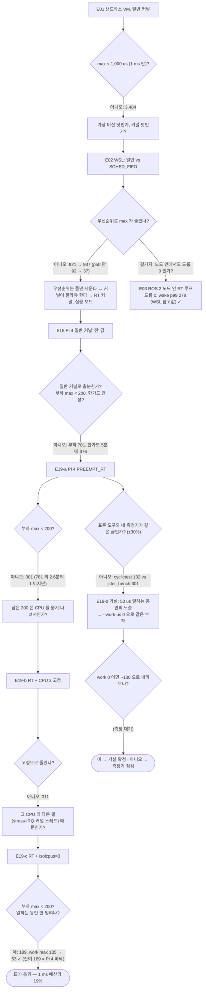
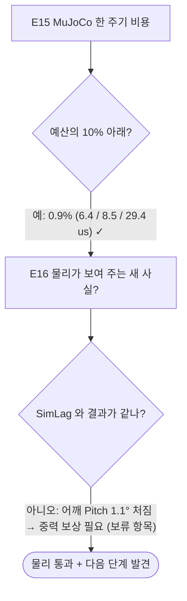

# 실험 목록 — 무엇을 물었고, 어떻게 쟀고, 무엇이 나왔나 (한 표)

`docs/LOG.md` 는 시간순(깨진 것·원인·해결)이라 "어떤 실험을 했나"를 한눈에 보기 어렵다. 이 표는 그 색인이다.
숫자 옆에는 항상 **환경**과 **원본 파일**(`docs/measurements/`)이 붙는다 — 환경이 다르면 같은 숫자가 아니다.
각 줄의 자세한 이야기는 "기록" 열의 LOG 절에 있다.

## 0. 실험의 흐름 — 어떤 기준을 못 넘어서 다음 실험으로 갈라졌나 (순서도)

사각형은 실험(번호는 아래 표), **마름모는 결과에 들이댄 기준(합격선)**, 화살표의 글은 그 기준에 대한 답이다.
실험은 미리 짠 목록이 아니라 **기준을 못 넘을 때마다 "왜?"를 하나 더 묻는 식**으로 생겼다. 기준을 넘은 가지는 거기서 끝난다.
(GitHub 에서 그림으로 보인다. 글로만 보면: 표① `E01 ✗ → E02 ✗ → E18 ✗ → E19-a ✗ → E19-b ✗ → E19-c ✓`, 곁가지 `E19-a 도구 불일치 → E19-d`; 표② `E04 작은 크기 ✓ → 1 MB ✗ → Cyclone ✓`; 표③ `E05 ✓ → E06 ✗(증거 불일치) → E07 → E08 ✓ → E13 ✓`, 곁가지 `E09·E10·E11·E12`.)
각 실험의 상세 페이지(왜 했나 · 결과 · 처음 읽는 사람을 위한 분석)는 [`experiments/`](experiments/README.md) 에 하나씩 있다.

### 표① 실시간 지연 — 합격선: 부하 중 max < 200 us, 한가/부하 차이 작음, 두 도구가 같은 급

### 표② DDS — 합격선: 1 MB 메시지도 손실 0

### 표③ 관제·장애 — 합격선: 장애 뒤 유실 0 이고, 그 0 이 다른 증거(diag)와 맞는다

### 물리 시뮬레이션 — 합격선: 물리 비용이 1 ms 예산의 10% 아래
(E03 의 "노드 안 1 kHz" 가 통과한 뒤 "물리 비용도 1 ms 안에 드나?" 로 이어진 가지.)

## 1. 실시간 루프 (표①)

| # | 질문 | 어떻게 | 결과 | 환경 | 원본 | 기록(LOG) |
|---|---|---|---|---|---|---|
| [E01](experiments/E01.md) | 가상 머신·일반 커널에서 1 kHz 루프가 지켜지나? | `jitter_bench --no-rt` 5 s | p99.9 2,568 / max 3,484 us — 주기의 3배 늦게 깸 | 샌드박스 VM | `jitter_sandbox_generic.json` | 11/03 D0 |
| [E02](experiments/E02.md) | 우선순위(SCHED_FIFO)만으로 꼬리가 잘리나? | WSL 에서 일반 vs `--prio 80` | p50 92 → 37 us 좋아짐, **max 921 → 937 us 그대로** — 우선순위는 줄을 앞세울 뿐 커널을 멈추지 못한다 | WSL2 | `jitter_wsl_generic.json`, `jitter_wsl_fifo.json`, `table1.md` | 11/03 D0 WSL |
| [E03](experiments/E03.md) | ROS 2 노드 안에서도 1 kHz·드롭 0 이 유지되나? 워치독·변화량 제한이 동작하나? | `rt_control_node` + 50 Hz 명령, `/rt_status` 1 Hz | wake p99 278 / max 679 us, 드롭 0, watchdog trips 1, step_limited 10, `/joint_states` 100.0 Hz | WSL2 | `rt_status` 출력(LOG) | 11/03 D1 |
| [E15](experiments/E15.md) | 물리 시뮬레이션(MuJoCo, SO-ARM100 6축) 한 주기 비용이 1 ms 예산의 얼마인가? | `test_mujoco_backend` 2,000주기 · 노드 안 `work_us` | 러너 p50 6.4 / p99 8.5 / max 29.4 us(예산의 0.9%) · WSL 단독 4.9 / 6.3 / 20.8 · 노드 안(제어+물리) 41 / 145 / 247 us | GitHub 러너 · WSL2 | `mujoco_backend_ci.json`, LOG | 11/04 CI 2차 · MuJoCo WSL |
| [E16](experiments/E16.md) | 물리가 있으면 SimLag 로는 못 보는 무엇이 보이나? | 목표 [0.3, −0.2, 0.1, 0, 0, 0.5] 를 주고 정상 상태 위치 읽기 | 어깨 Pitch 만 −0.180 (목표 −0.200, **1.1° 처짐**) = 중력에 걸린 position 액추에이터의 정상 상태 오차 → 중력 보상이 필요한 숫자 근거 | WSL2, MuJoCo | LOG | 11/04 MuJoCo WSL |
| [E18](experiments/E18.md) | **Pi 4 일반 커널**(6.8 raspi)의 지연 꼬리는? — RT 비교의 "전" | `jitter_bench --prio 80` 60 s · `cyclictest` 4 CPU 300 s / 120 s, 한가·부하 | jitter max **24.9 / 781.2** us · cyclictest max **376 / 695** us(p99.9 57 / 118). 한가해도 5분 창에선 376. 부하 중 `work time` max 134.9 — 일하다 밀림. 온도 45→75 °C, 스로틀 0 | **Pi 4B**, Ubuntu 24.04, RT 아님 | `table1_pi4.md`, `*_pi4_generic_*` | 11/04 밤 |
| [E19](experiments/E19a.md) (a·[b](experiments/E19b.md)·[c](experiments/E19c.md)·[d](experiments/E19d.md)) | PREEMPT_RT 가 E18 의 max 를 얼마로 줄이나? CPU 고정·isolcpus 는? 두 도구가 같은 급인가? | 같은 4조건 + `--cpu 3` + `isolcpus=3` + `--work-us 0` | cyclictest max 한가 **37**(376→) / 부하 **132**(695→). jitter 부하 max **781 → 301**(RT) → 311(고정, 효과 없음) → **189**(격리), work max 135 → 53. 비용: p99 146 → 185. 도구 불일치 2.3배 → work-us 0 검증(E19-d, 측정 대기) | **Pi 4B**, `6.8.0-2054-raspi-realtime`, 스로틀 0 | `*_pi4_rt_*`, `table1_pi4.md` | 11/05 |

## 2. DDS (표②)

| # | 질문 | 어떻게 | 결과 | 환경 | 원본 | 기록(LOG) |
|---|---|---|---|---|---|---|
| [E04](experiments/E04.md) | 구현체(Fast DDS·Cyclone) × QoS(reliable·best_effort) × 크기(64 B~1 MB)에서 손실·왕복 지연은? | `dds_bench/run_matrix.sh` 16조합, rclpy | 64 B~64 KB 는 전부 손실 0, RTT p50 0.9~1.2 ms. **1 MB: Fast DDS best_effort 99.8% 손실, reliable 22.8%, Cyclone 0%**(reliable p50 4.4 ms) | WSL2, 같은 PC | `dds_*.json` 16개, `table2.md` | 11/03 D1 |

## 3. 관제·장애·OTA (표③)

| # | 질문 | 어떻게 | 결과 | 환경 | 원본 | 기록(LOG) |
|---|---|---|---|---|---|---|
| [E05](experiments/E05.md) | 가상 50대 1 Hz 의 전달 지연은? 브로커가 10초 죽으면 장치 버퍼가 일을 하나? | 수집기 1 s 묶음 COPY, 대시보드 | 전달 지연 p50 0.9 / p95 1.8 ms. 중단 10초 → 버퍼 654 = 재전송 654, 재접속 50, 복구 폭주 600 msgs/s | WSL2 | `table3.md` ③-1 | 11/03 D2 |
| [E06](experiments/E06.md) | 장애 4종(broker·db·collector·bad_firmware)의 감지·복구·유실은? | `fleet/chaos/inject.py` + `assert_results.py` | broker 10 s → 전 장치 복귀 2.9 s · db 10 s → backlog 0 까지 1.4 s, 뒤늦게 570행 · collector(QoS 1) 10 s → 1.6 s · 나쁜 펌웨어 3/50 에서 롤백 1.0 s. 유실은 "0"이었으나 → E07 | WSL2 | `fault_*.json`, `ota_*.json` | 11/04 D5 1차 |
| [E07](experiments/E07.md) | 유실 "0" 이 진짜인가? | 유실 기준점을 장애 창 안 min(seq) → **장애 직전 30초의 마지막 seq** 로 고침, `diag.py` C절 | broker 재측정 **유실 53 / 1434**. 원인 셋: ① 브로커 재시작 경쟁(persistence false, 4~5대 × 12개) ② 수집기 종료 순간 장치당 1개(pending 1초) ③ 큐 상한 | WSL2 | LOG | 11/04 D5 2차 |
| [E08](experiments/E08.md) | ①② 를 고치면(persistence true + 곱게 종료) 유실이 0 이 되나? | 같은 주입 재측정 | broker **0 / 1400**, collector(QoS 1) **0 / 1311**, 복귀 2.9 s / 1.6 s, diag C "틈 없음" | WSL2 | `fault_broker.json`, `fault_collector_qos1.json`, `table3.md` ③-2 | 11/04 D5 2차 결과 |
| [E09](experiments/E09.md) | 오프라인 이벤트가 50 이 아니라 왜 20 인가? | `diag.py` A절(군집), `events` 시각 비교 | 20개가 같은 1 ms 안 = **브로커 종료 시 일괄 유언**을 소켓 닫기 전까지 쓴 만큼. 장치는 멀쩡 | WSL2 | LOG | 11/04 D5 1차 결과 |
| [E10](experiments/E10.md) | 전달 지연이 10초마다 튀는 원인이 keepalive 인가? | A/B: `--keepalive 30` vs `10`, `diag.py` B절 | 30 s → **튐 0회**(172 s), 10 s → 튐 간격 **정확히 10.0 s** → keepalive 박자 확정. 해법: 장치별 keepalive jitter | WSL2 | LOG | 11/04 소실험 |
| [E11](experiments/E11.md) | QoS 0 이면 수집기 10초 중단에 얼마를 잃나? | 수집기·장치 모두 QoS 0 으로 같은 주입 | **508 / 1312**(예측 500 = 50대 × 10 s) vs QoS 1 지속 세션 0 / 1311 | WSL2 | `fault_collector_qos0.json` | 11/04 소실험 |
| [E12](experiments/E12.md) | 지속 세션은 무한히 보관하나? | 수집기가 7.5분 비어 있던 사고를 그대로 측정 | 412 s × 50 ≈ 20,600 까지 보관, 그 뒤 **2,450개 버림** = `max_queued_messages 20000`. Mosquitto 는 꽉 차면 새 메시지를 버린다 | WSL2 | LOG | 11/04 D5 2차 |
| [E13](experiments/E13.md) | 같은 장애 4종이 다른 환경(GitHub 러너, 10대 2 Hz)에서도 같은 모양인가? | CI `fleet_integration` (진짜 컨테이너) | 유실 0/318 · 0/286 · 0/280, 롤백 0.4 s — 환경이 아니라 설계가 만든 숫자 | ubuntu-24.04 러너 | `table3_ci.md` | 11/04 CI 2차 |

## 4. 사고·함정 (실험은 아니지만 "뭐가 안 됐고 어떻게 풀었나"의 소재)

| 무엇 | 원인 | 해결 | 기록 |
|---|---|---|---|
| 재시작된 수집기가 바로 죽음 | `/proc/<pid>/exe` 는 venv 를 잃은 경로 | `environ` 의 VIRTUAL_ENV·PATH 로 같은 환경 재시작 | 11/04 D5 1차 |
| 수집기 둘·가상 장치 두 벌이 2초마다 서로 밀어냄(reconnects 1,675) | 같은 MQTT client_id | `fleet/common/single_instance.py` flock 잠금 | 11/04 2차 결과 · 소실험 |
| persistence true 뒤 오프라인 이벤트 +50 | 보관(retained)된 유언이 재구독 때 다시 내려옴 | retain=1 상태는 "지금 상태"이지 사건이 아님 → events 제외 | 11/04 2차 결과 |
| CI `fleet_integration` 실패 | TimescaleDB 첫 기동의 임시 서버를 `pg_isready` 가 "준비됨"이라 함 | `migrate.py --wait` 가 소비자와 같은 경로(TCP)로 재시도 | 11/04 CI 1차 |
| `ros2 topic echo` 가 토픽을 못 봄 | 다른 RMW 로 떠 있던 ros2 데몬 | `ros2 daemon stop` | 11/04 MuJoCo WSL |
| colcon install 뒤 `libmujoco.so` 못 찾음 | install 단계에서 rpath 소실 | `CMAKE_INSTALL_RPATH_USE_LINK_PATH TRUE` | 11/03 D3~D5 |
| 노드가 파라미터 파일로 시작 안 됨 | 빈 배열 `mujoco_joints: []` 의 타입 미정 | 빈 배열이면 키를 뺀다 | 11/03 D3~D5 |
| Pi 결과 파일 복사·커밋 실패 | WSL 명령을 Pi 창에 침, sudo 가 만든 root 소유 파일 | 창 표시 [Pi 창]/[WSL 창], `chown -R` | 11/04 밤 |
| Ubuntu One 가입 실패(실시간 커널 토큰) | Launchpad 사용자명 검사 time out(Canonical 쪽) | 재시도 / 플랜 B 커널 직접 빌드 | 11/04 밤 |

## 5. 아직 안 한 것
- E19 Pi 4 PREEMPT_RT (토큰 대기), E20 `data_pipeline/record.sh` + `bag_to_csv.py` 의 WSL 첫 실행(rosbag2_py import 확인), 브로커 로그로 천둥 떼(thundering herd) 가설 확정, 수동 ACK(DB 적재 뒤 PUBACK) — 면접에서 "다음 단계"로 말할 것.
